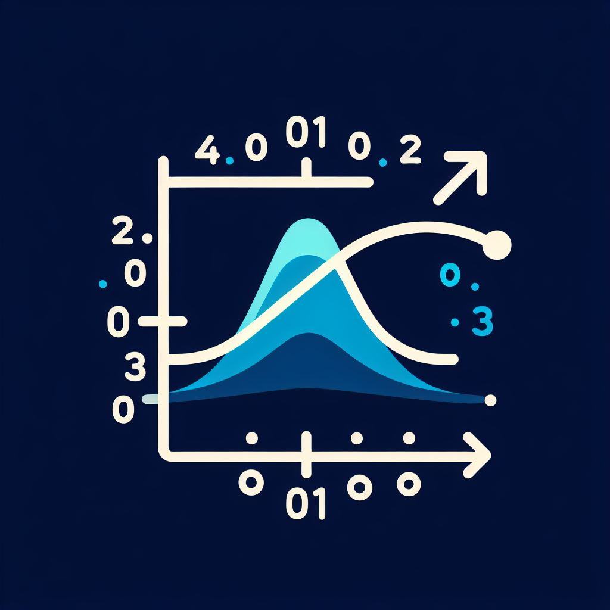

<p align="center">
  
</p>

# pydegas

Gradient-based optimization of probabilistic programs without sampling, based
on DeGAS ([arXiv:2601.15167](https://arxiv.org/abs/2601.15167)).

| Project | What it is |
|---|---|
| [pydegas](libs/pydegas/docs/index.md) | Python library |
| [degas-api](libs/degas-api/docs/index.md) | FastAPI service running optimizations over a WebSocket |
| [degas-ui](libs/degas-ui/docs/index.md) | web interface for the service |


---

- Use the library: [getting started](libs/pydegas/docs/getting-started.md)
- Run the web application locally: [local stack](docs/local-stack.md)
- Work on the code: [contributing](CONTRIBUTING.md)

## License

MIT; see [LICENSE](LICENSE). pydegas is a reimplementation of the DeGAS
reference code at [frarandone/DeGAS](https://github.com/frarandone/DeGAS).

## Citation

```bibtex
@misc{randone2026degasgradientbasedoptimizationprobabilistic,
      title={DeGAS: Gradient-Based Optimization of Probabilistic Programs without Sampling},
      author={Francesca Randone and Romina Doz and Mirco Tribastone and Luca Bortolussi},
      year={2026},
      eprint={2601.15167},
      archivePrefix={arXiv},
      primaryClass={cs.PL},
      url={https://arxiv.org/abs/2601.15167},
}
```
